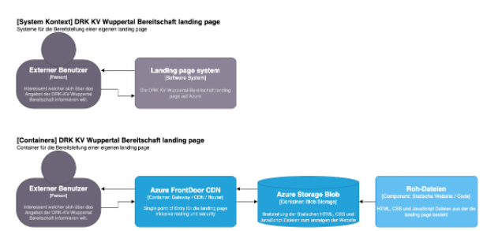

# DLBSEPCP01_D - Static Site

## Struktur

`/code/deployment` beinhaltet die bicep template zum erstellen der statischen website.

`/code/content` beinhaltet die webseite an sich (HTML und CSS).

`/img/` beinhaltet bilder welche auf dieser README angezeigt werden.

## Design und Architektur

Die Architektur basiert auf einem simplen Azure FrontDoor service welcher als Single-Point-Of-Entry fungiert und die Daten aus einem Azure Blob Storage global verfügbar macht.
Somit wird eine möglichst schlanke und kosten effiziente methode der Bereitstellung verwendet.

## Anleitung

**Erstellen der Services:**

1. Als erstes wird eine Azure Subscription inkl. Azure Account benötigt
1. Aufrufen des Azure Portals: `https://portal.azure.com`
1. Öffnen der cloud-shell mittels klick auf das cloud-shell-icon oben rechts
1. Erstellen einer neuen Resource-Group mittels: `az group create --name rg-drk-wuppertal --location westeurope`
1. Anlegen des deployment ordners: `mkdir deployment`
1. Wechseln in den deployment ordner: `cd deployment`
1. Erstellen der bicep datei innerhalb der cloudshell: `code main.bicep`
1. In dem nun offnene code-editor den inhalt von `/code/deployment/page.bicep` einfügen.
1. Nun folgenden befehl ausführen und das deployment starten: `az deployment group create --resource-group rg-drk-wuppertal --template-file main.bicep`
1. Abwarten bis de meldung "Success" ausgegeben wird. Von nun an kann die Ressource genutzt werden

**Hochladen der Website:**

1. Herunterladen der dateien `index.html` und `style.css` in dem ordner `/code/content`
1. Nun müssen die Daten in den `$web` ordner des Storage Blob Containers hochgeladen werden.
    1. Öffnen des Storage Accounts. In diesem fall befindet sich dieser in der Resource-Group `rg-drk-wuppertal` und ist zu finden unter dem namen `drkkvwuppertaldemo01`
    1. Auf der linken seite auf den punkt `Datastorage\Containers` clicken
    1. Nun den ordner `$web` anwählen
    1. Zum schluss auf die Schaltfäche `Upload` clicken

**Aufrufen der Webseite:**

Um die Webseite auf zu rufen wird die FrontDoor addresse benötigt. Diese findet sich im Overview, innerhalb der FrontDoor Ressource, unter dem punkt `Endpoint Hostname`

**HINWEIS:** In der erprobung wurde festgestellt, dass Änderungen ggf. mehere minuten dauern können. Daher ist es ratsam ca. 30min bis 60min. zu warten bevor Azure FrontDoor funktioniert.